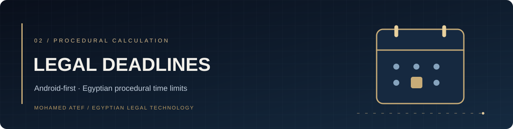
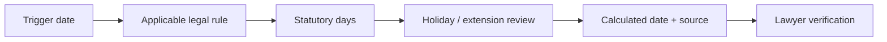

<div align="center">


# حاسبة المواعيد القانونية المصرية
**Egyptian Legal Deadlines Calculator**

[GitHub project](https://github.com/matef-hub/Egyptian-Legal-Deadlines-Calculator) · [Developer](https://github.com/matef-hub)
</div>

## Purpose

An **Android-first** legal deadline calculator written in **Kotlin** and built with **Jetpack Compose**. It is intended to help Egyptian legal practitioners examine procedural time limits, holidays and calendar-related effects while keeping the underlying legal basis visible for review.

The repository also contains historical web UI files; **the supported product direction is Android**, not a separately maintained web edition.

## Experience

- Arabic legal-rule library with a citation and explanatory notes for each rule.
- Day-based calculations; no hourly or sub-day deadlines.
- Starting event, relevant rule, calendar adjustments and resulting date shown as a reviewable chain.
- Editable legal references and a distinct **needs verification** state when text or legal authority is incomplete.
- Local storage for saved work, using the Android application modules.



## Android project

The Android sources are in `app/`; the root [Gradle settings](settings.gradle.kts) includes the `app` module. Open this repository in a recent **Android Studio**, install the required Android SDK, and build locally.

```powershell
.\gradlew.bat :app:assembleDebug
```

Do not commit signing keys, secrets or local configuration values. Google/API-related capabilities may require separate setup.

## Important legal limitation

**This calculator is an aid to verification, not an authoritative statement of Egyptian law.** The validity of any specific period depends on its current legislative text, transitional provisions, the procedural event, court practice and applicable public holidays. A missing or unverified article should remain visibly marked until reviewed; entering text alone does not establish that it has been checked against an official source.

**Author:** [Mohamed Atef](https://github.com/matef-hub) — Egyptian lawyer and legal-tech developer.
